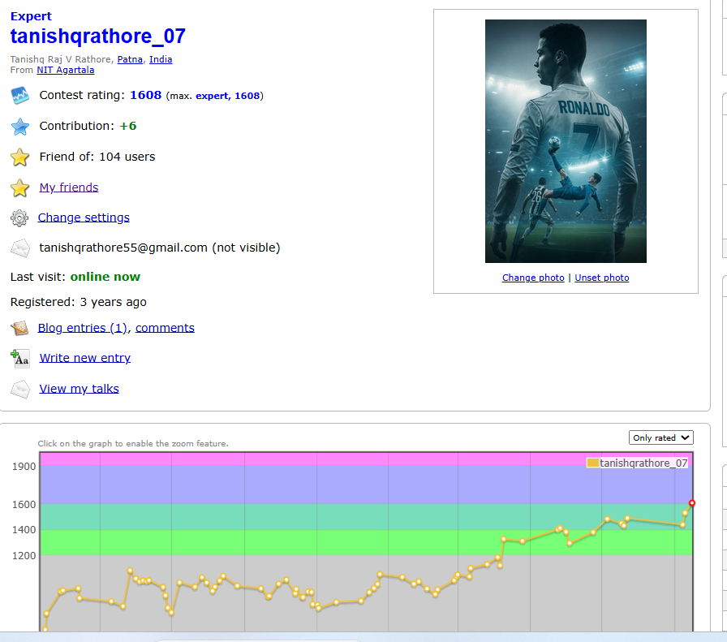
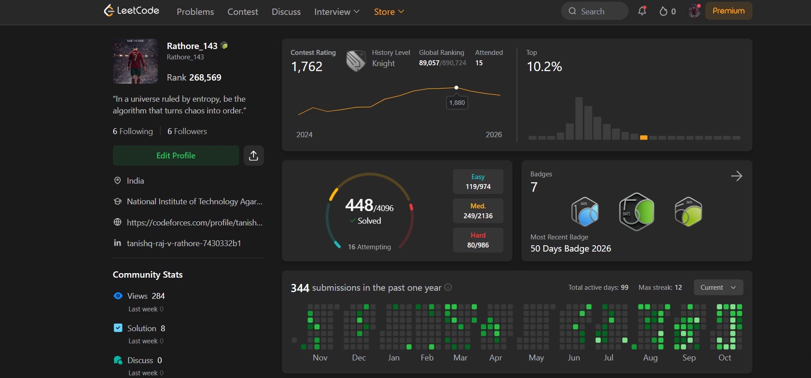

 

---

## 👨‍💻 About Me

- 🎓 Electronics & Instrumentation Engineering student at **NIT Agartala**.
- 💻 Passionate about Backend Engineering, System Design and Problem Solving.
- 🚀 Building scalable applications and exploring distributed systems.
- 🏆 **Codeforces Expert** — Maximum Rating: 1608.
- 🌍 ICPC participant — Team Global Rank 1074.
- 👨‍🏫 Enjoy mentoring students and teaching programming.
- 🌱 Currently exploring advanced backend engineering.

---

## ⚡ Tech Stack

**Languages**

**Backend & Frontend**

**Databases & Tools**

---

## 🚀 Featured Projects

### 01. Distributed Job Scheduler

A distributed job scheduling platform built to manage and execute jobs efficiently.

- Cron-based job scheduling.
- DAG-based job dependencies.
- JWT authentication.
- Real-time execution updates using WebSockets.
- PostgreSQL-backed job management.

**Stack:** Java · Spring Boot · PostgreSQL · React · WebSockets · Docker

### 02. Smart Expenser

A full-stack expense tracking application with intelligent expense categorization and data visualization.

**Stack:** React · Node.js · Express · MongoDB · Python

### 03. Northeast Crafts Platform

An e-commerce platform promoting traditional crafts and products from Northeast India.

**Stack:** React · Node.js · Express · MongoDB

---

## 🧠 Competitive Programming

### Codeforces

### LeetCode

---

📊 GitHub Presence

---

## 🤝 Let's Connect

 

**"Code. Learn. Build. Repeat."** 💻

